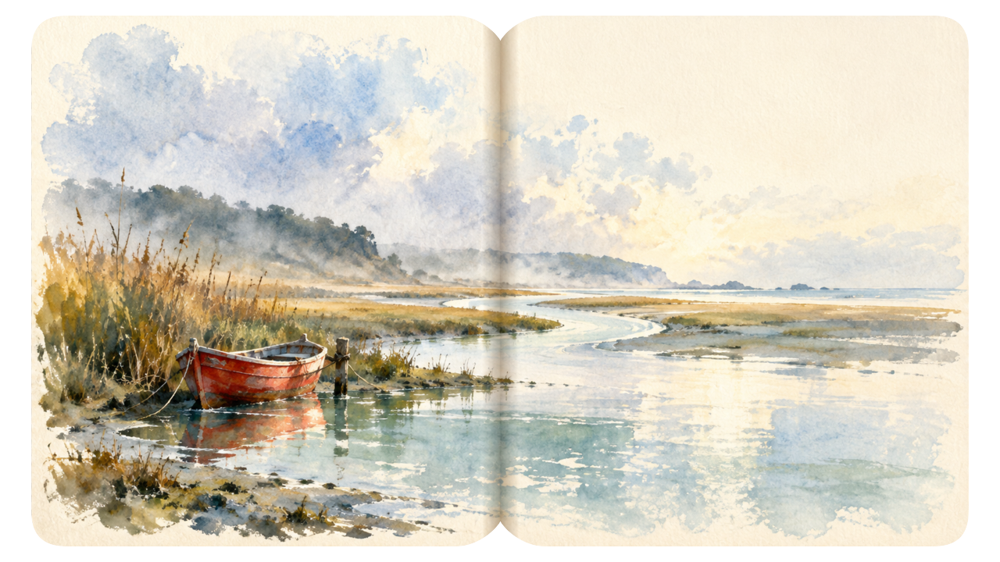
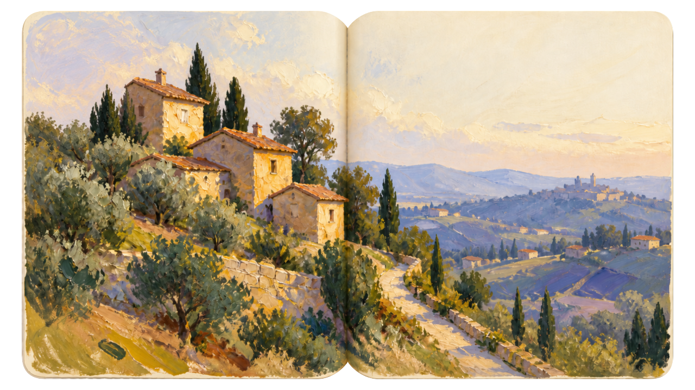
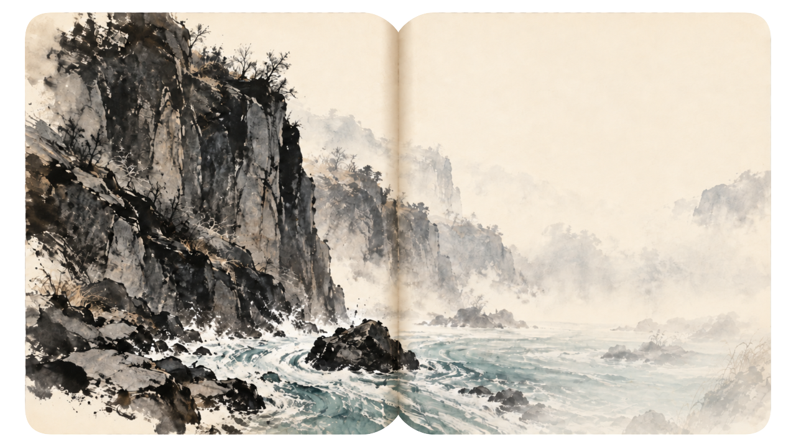
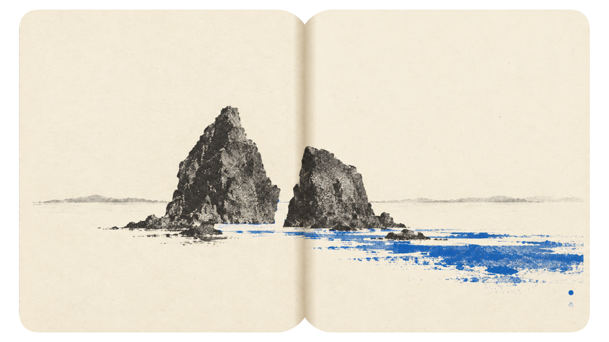
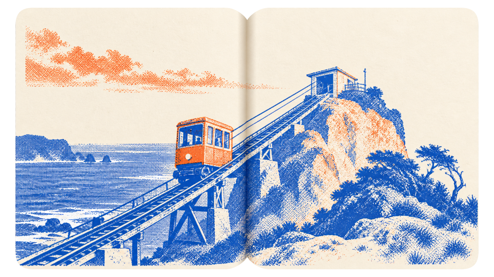
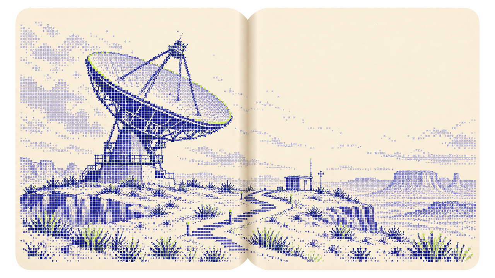
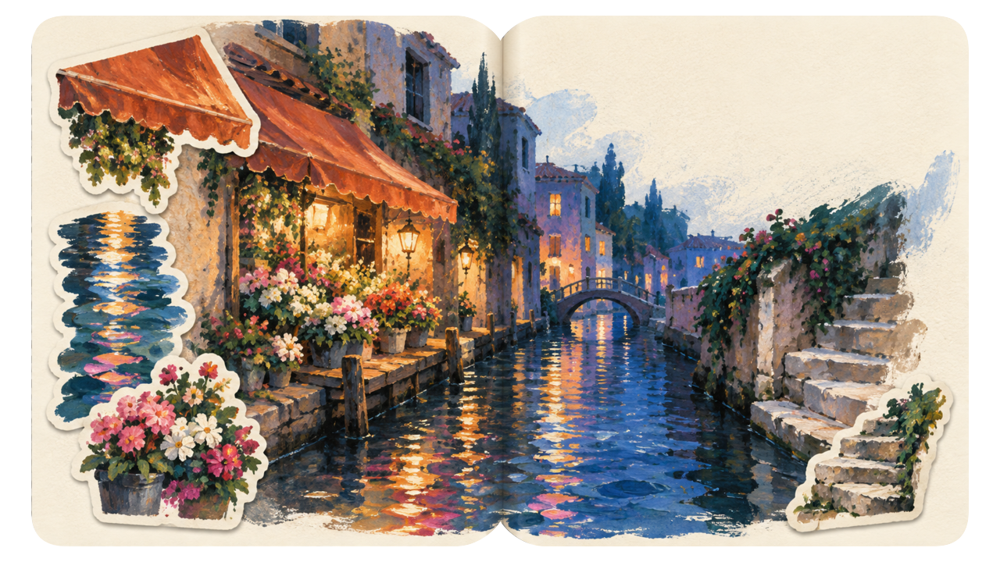

<div align="center">

**中文** · [English](./README.md)

# Sketchbook

**生成带日期、地点印章的完整开本旅行手帐。**

[](./SKILL.md)
[](./references/style-system.md)
[](./references/extended-styles.md)

</div>

输入日期、地点和可选参考照片，生成一张完整的 Sketchbook 开本图片。每张图都包含可见双页和中间装订痕，但没有深色封边、硬壳或外露页签；纸张内保持不透明，书本外侧则是透明画布，旅行场景铺满页面，而不是作为悬在纸上的小透明贴片。

Skill 支持传统绘画、编辑印刷、精细点阵和照片场景提炼，同时保持统一契约：`1280×720` 画布、固定 `1200×680+40+20` 书页轮廓、固定右上角印章、手写日期和随机外形的崇羲篆体地点印章。首页把这些完整开本渲染在独立且静止的相簿底板上。

## 风格参考图

| 水彩 | 油画 | 中国水墨 | 极简杂志 |
|:---:|:---:|:---:|:---:|
|  |  |  |  |

| 单 / 双色孔版 | 点阵日记 | 场景提纯 | 旅行记忆拼贴 |
|:---:|:---:|:---:|:---:|
|  |  |  |  |

这些原创图片用于说明构图、密度与媒介语法，不是供复刻的主体或模板。

像素贝壳是第九种由提示词定义的风格。它只使用用户上传照片作为视觉来源，并读取 [`pixel-shell-style.md`](./references/pixel-shell-style.md)，不使用额外的捆绑参考图。

## 它能做什么

| 系统 | 方向 |
|---|---|
| **必需输入** | 真实日期与地点 / 景点 |
| **可选输入** | 参考照片与明确风格 |
| **画布** | `1280x720` RGBA 完整开本，书外透明 |
| **书本** | 固定 `1200×680+40+20` 轮廓、干净双页与中间装订痕，没有封边、硬壳或层叠纸叶 |
| **标记** | 固定右上印章与日期；地点印章外形、位置和满足对比度的印色随机 |
| **顺序** | ISO 日期升序，同日按 id 排序 |
| **输出** | 完整开本 PNG、完整 Prompt、风格配方、印章元数据、注册状态与验证结果 |

## 完整开本模式

```text
完整开本底图      纸张 + 双页 + 装订痕 + 旅行插画
                     ↓
合成标记          固定红印 + 手写日期 + 对比度感知的随机地点印
                     ↓
注册结果          一张密度完整、具有手感的旅行手帐
```

最终 PNG 故意包含一张完整打开的双页纸。书本外侧透明，书内纸张和内容保持实体感。它不能是空白画布中的小书、透明剪贴层、只有一页有内容的产品 Mockup、深色封边、硬壳，或左侧露出层层纸页的装帧。贴纸只属于明确选择的旅行记忆拼贴风格。该完整开本会直接注册为首页轮播图。

## 九种风格

- **水彩**：湿画法晕染、宽阔色块、无轮廓线
- **油画**：厚涂、破色、扫擦与少量调色刀痕
- **中国水墨**：墨色层次、笔势、渗化与空气感
- **极简杂志**：一个紧凑关系，安静区域仍保留纸张质感和轻度视觉处理
- **单 / 双色孔版**：一至两块职责明确的印版、网点与受控套印偏移
- **点阵日记**：细密点阵结构，不做游戏像素风
- **像素贝壳**：必须提供照片，按主体复杂度自适应使用哑光贝壳/矿物方片，不限制数量，但禁止密集微型马赛克；不保留照片区域或照片像素
- **场景提纯**：必须提供照片，提炼语义但不保留照片像素
- **贴纸旅行记忆**：必须提供照片，保留真实锚点并加入三到五张来源衍生的异形贴纸

## 工作方式

```text
1  校验输入      →  必须有日期与地点，再选择风格
2  编译场景      →  记录地点主体或照片保真约束
3  生成开本      →  干净双页、装订痕、书外透明、完整旅行插画，不含生成文字、标记或默认贴纸
4  生成标记      →  独立生成准确日期与崇羲篆体地点印章
5  归一化与合成  →  建立统一 Alpha，再为地点印抽取安静位置与高对比印色
6  检查并注册    →  检查装订、覆盖率、书外 Alpha 与缩略图清晰度；仅旅行记忆拼贴检查贴纸质感
```

## 试一试

```text
使用 $sketchbook 生成 2026-09-18 杭州西湖的水彩 sketchbook。
```

```text
使用 $sketchbook 生成 2027-05-12 青岛栈桥的蓝橙双色孔版印刷版本。
```

```text
使用这张照片做 2027-09-10 阿里山的 Gathered Memory sketchbook。
```

```text
使用这张照片做 2027-10-12 青海湖的像素贝壳 Sketchbook。
```

日期或地点缺失时，Skill 会在调用工具前只询问缺少的字段；需要照片的风格若没有照片，也会停止并索取照片。

## 稳定印章与日期系统

- `assets/seal.png` 直接合成，imagegen 不重绘。
- `assets/handwriting-latin-glyph-sheet.png` 只用于生成独立透明日期层。
- `assets/chongxi_seal.otf` 控制地点印章每个字的字形与绝对位置。
- 四字地点印章默认使用真正的回文路径：`右上 → 左上 → 左下 → 右下`。
- 地点印章外形每次从符合字数的候选中重新随机。
- 地点印章位置从页面边缘的安静候选区抽取；印色只会在达到当前底色对比度阈值的候选中随机。

## 验证

```bash
python3 "${CODEX_HOME:-$HOME/.codex}/skills/.system/skill-creator/scripts/quick_validate.py" \
  .agents/skills/sketchbook

node .agents/skills/sketchbook/scripts/inspect-native-alpha.mjs \
  --input GENERATED.png

node .agents/skills/sketchbook/scripts/normalize-book-spread.mjs \
  --input GENERATED.png \
  --output NORMALIZED.png

npm run check
git diff --check
```

成品流程首先要求原生透明 PNG，并在任何缩放前检查真实 Alpha；执行工具提供参数时，最终图优先使用 GPT Image 2.5 Sunburst 的 high 或 xhigh 质量与透明背景。原生透明检查失败后，才使用人工复核边界与默认 3px 内缩的硬种子蒙版，避免黑底参与缩放插值。归一化随后检查纸张内部、书脊缺口、外部泄漏和半透明暗边；人工审美复核仍会淘汰模型直接画出的描边、通用明信片构图和滤镜式风格。

生成输入改用中性的 `assets/paper-geometry.png`，旧版带封面和叠页的 canonical shell 不再传给生成器。在 skill 目录运行 `node scripts/create-paper-reference.mjs` 可重建这个几何参考。

标记合成器按最终尺寸的核心笔画检测局部对比度：至少 90% 笔画达到 3.2:1，并校验固定印章、日期和人物/景物/贴纸避让区域。支持 `--seed` 复现、`--exclude-regions` 避让、`--dry-run` 只读预检、`--report` 保存记录；无合格位置会报错。命令和恢复流程见 [production.md](./references/production.md)。

xue 项目沿用用户授权：单张成图通过验收后默认加入首页，比较批次和明确预览请求等待选定。注册器按日期及同日 ID 插入，完全相同的重复请求不再写文件，冲突时保留现有配置，其他图片继续保留。

运行依赖为 Node、`sharp`、`yaml`；字形和纸张归一化使用 ImageMagick 7。内置生图工具无需配置 API key。标记布局、透明检测与注册回归测试不调用图像生成服务。

## 目录结构

```text
sketchbook/
├── agents/openai.yaml       # UI 名称与默认调用
├── assets/                  # 布局清单、材质参考、印章、字体、手写字形与参考图
│   └── references/          # 八张图像参考；像素贝壳由专用提示词定义
├── evals/evals.json         # 典型行为评测
├── references/              # 风格、Prompt/生成记录、印章、照片、质检与接入规则
├── scripts/                 # 归一化、标记合成、印章辅助与首页注册
├── SKILL.md                 # Skill 入口与工作流
├── README.md                # English documentation
└── README.zh.md             # 中文说明
```

## 原创性

参考图定义的是媒介、留白、复制工艺和细节压缩规则。每次结果都根据用户提供的地点、日期与照片重新构图，不复制参考图的主体或排列。

## 资产许可

`assets/chongxi_seal.otf` 按 CC BY-ND 3.0 台湾及其后版本原样再分发。署名、来源、校验值和官方许可地址记录在 [`ASSET-LICENSE.md`](./ASSET-LICENSE.md)；该字体不适用本仓库的 MIT License。
